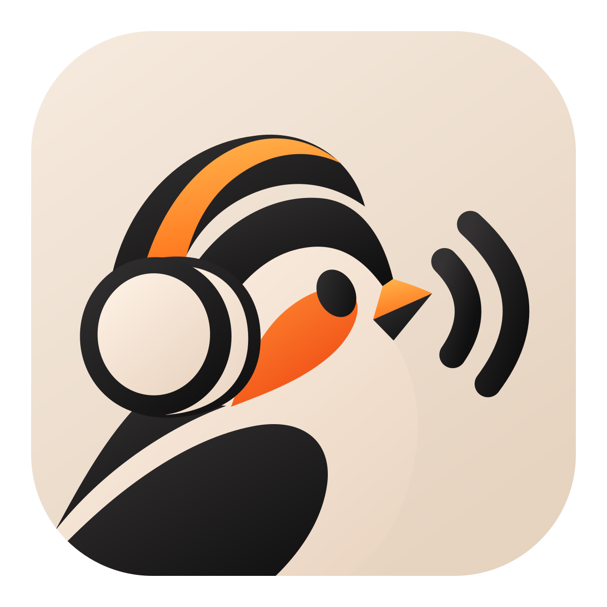

<p align="center">
  
</p>

<h1 align="center">FinchSpeak</h1>

<p align="center"><strong>Голос, экран и музыка для своих — на своём сервере.</strong></p>

<p align="center">
  Настольное приложение для голосового общения, чата и демонстрации экрана.<br>
  Сервер запускается за пять минут на любом ПК или VPS. Ваши разговоры остаются у вас.
</p>

<p align="center">
  <a href="https://github.com/qwers451/FinchSpeak/releases/latest"></a>
  
  
  <a href="LICENSE"></a>
</p>

<p align="center">
  <a href="https://github.com/qwers451/FinchSpeak/releases/latest"><b>Скачать</b></a> ·
  <a href="#запуск-за-пять-минут">Запуск за пять минут</a> ·
  <a href="docs/RELEASE-NOTES-1.7.0.md">Что нового</a>
</p>

---

## Почему FinchSpeak

**Ваш сервер — ваши правила.** FinchSpeak работает там, где вы его запустили: на домашнем ПК, на офисном сервере или на недорогом VPS. Никаких чужих аккаунтов, рекламы, подписок и урезанных возможностей. База, файлы и история переписки лежат у вас в одной папке.

**Быстро там, где это важно.** Сервер написан на Rust и пересылает голос и видео как есть, без перекодирования, поэтому задержка минимальна. Он настолько лёгкий, что работает в контейнере с лимитом 256 МБ и в покое занимает несколько мегабайт памяти.

**Звук, за который не стыдно.** Подавление эха и автоусиление из WebRTC, нейросетевое шумоподавление RNNoise и кодек Opus. Тест микрофона проигрывает запись только вам, push-to-talk работает и при свёрнутом окне.

**Всё в одном окне.** Голос, текстовые каналы, демонстрация экрана со звуком, общий плеер для комнаты, роли и модерация — без плагинов и доустановок.

## Что внутри

### Голосовые комнаты
- Push-to-talk, отдельная громкость каждого участника, пространственный звук.
- Меню участника по правому клику: громкость и «заглушить у себя», а для модераторов — заглушить для всех, переместить, убрать из комнаты.
- Модераторы перетаскивают людей между комнатами; каждый может перетащить себя и выстроить плитки в удобном порядке.
- Пять анимаций говорящего на выбор; иконка в трее показывает, когда вы говорите.
- **Саундборд** — общая доска коротких звуков, которые слышит вся комната.
- **Позвать стаю**: одна кнопка переносит вас в другую комнату и зовёт остальных за собой.
- **Мини-окно поверх игры**: кто в комнате и кто говорит, не выходя из игры. Выключается в настройках.

### Демонстрация экрана
- Экран или отдельное окно, **30 или 60 кадров в секунду**, системный звук без голосов из самого FinchSpeak — эха не будет.
- Захват через Windows Graphics Capture, декодирование у зрителя через WebCodecs.
- Можно показать свёрнутое окно, например игру после Alt+Tab: картинка появится, как только окно развернут.
- Если компьютер не успевает кодировать 60 кадров, демонстрация сама переходит на 30 и сообщает об этом.

### Музыка комнаты
- Общий плеер: трек из библиотеки на сервере или файл со своего компьютера — MP3, OGG, FLAC, WAV.
- Играет синхронно у всех. Очередь, пауза, перемотка и пропуск доступны каждому участнику, громкость музыки у каждого своя.
- Временные файлы удаляются после проигрывания, лимиты задаются в конфиге сервера.

### Чат
- Текстовые каналы с ответами, реакциями, упоминаниями, вложениями и поиском по истории.
- **Голосовые сообщения** с волной и ускоренным воспроизведением.
- Уведомления Windows с аватаром и кнопками: на зов в комнату можно ответить прямо из уведомления.

### Сервер под вашим контролем
- Регистрация по приглашениям, роли администратора и модератора, кик, бан и журнал действий.
- Автоматические резервные копии базы и вкладка «Здоровье»: память, диск, трафик и графики за последний час.
- Список участников, в том числе не в сети, статусы и «во что играет» — показ своей игры отключается в настройках.

### Оформление
- Четыре темы: **Claude Dark**, **Снегирь** в цветах логотипа, **Finch Custom** и **Своя** — из шести цветов или из картинки.
- Живые анимации и мягкие звуки, включая набор «Птицы».
- **Режим Finch**: всё окно превращается в дерево, где голосовые комнаты — гнёзда, а текстовые каналы — скворечники.
- Русский и английский интерфейс без перезапуска; учитывается системная настройка уменьшения движения.

## Запуск за пять минут

Берите файлы **из одного выпуска** на странице [Releases](https://github.com/qwers451/FinchSpeak/releases/latest).

### Шаг 1. Сервер

**На Windows.** Распакуйте `FinchSpeak-server-windows.zip` в папку, доступную для записи, и запустите `Run_Server.bat`. Окно сервера оставьте открытым.

**Или на Linux в Docker:**
```bash
git clone https://github.com/qwers451/FinchSpeak.git
cd FinchSpeak/deploy
docker compose up -d --build
```
Данные сохраняются в `deploy/data`, настройки — в `deploy/finch-server.toml`.

В обоих случаях откройте **TCP 8443** (вход и файлы) и **UDP 4433** (голос и видео). Для доступа из интернета пробросьте эти порты на роутере.

### Шаг 2. Клиент

1. Установите `FinchSpeak_<версия>_x64-setup.exe` на каждом компьютере.
2. Введите адрес сервера: `https://IP-СЕРВЕРА:8443`, например `https://192.168.1.50:8443`.
3. Сверьте отпечаток сертификата с тем, что показывает сервер, и подтвердите — это защита от подмены сервера.
4. Первый зарегистрированный аккаунт становится администратором. Остальных приглашайте кодом: **Администрирование → Приглашения**.

Клиент сам находит и ставит обновления, проверяя их подпись. Подробный сценарий проверки на двух ПК — в [чек-листе](docs/RELEASE-CHECKLIST.md).

## Безопасность — честно

- Соединение с сервером защищено **TLS 1.3**. При первом подключении клиент просит подтвердить отпечаток сертификата, а при его смене предупреждает.
- Пароли хранятся в виде хэшей **Argon2id**; свои сессии на других устройствах можно завершить из настроек.
- Сквозного шифрования между участниками нет: сервер ваш, и его администратор управляет им так же, как любым своим сервером.
- Установщик не подписан сертификатом Authenticode, поэтому Windows может показать предупреждение SmartScreen. Сверяйте файлы с `SHA256SUMS.txt` из того же выпуска.

## Данные и обновление сервера

Всё состояние сервера — база `finchspeak.db`, вложения, музыка, журналы, резервные копии и TLS-ключ — лежит в его папке (в Docker — в `deploy/data`). Перед обновлением остановите сервер и сохраните эту папку целиком, затем замените файлы и запустите снова. Клиенты обновляются сами.

## Для разработчиков

Клиент — **Tauri 2** и **SolidJS**, сервер и медиатракт — **Rust** (Tokio, QUIC на Quinn, Axum, SQLite). Голос идёт датаграммами QUIC, ключевые кадры видео — отдельными потоками, управляющие сообщения — в MessagePack.

Нужны стабильный Rust, Node.js, Windows C++ Build Tools и **NASM** в `PATH`: без него видеокодер OpenH264 собирается без SIMD и работает в несколько раз медленнее. Нативный аудиомодуль готовится отдельно, см. [NATIVE-AUDIO.md](docs/NATIVE-AUDIO.md).

```powershell
cd app/frontend
npm ci
npm test
npm run build
cd ../..
cargo test --workspace -- --test-threads=1
cargo clippy --workspace --all-targets -- -D warnings
```

Браузерный режим разработки (`npm run dev` в `app/frontend`, страница на `http://127.0.0.1:5173`) обращается к серверу из браузера, поэтому добавьте в `finch-server.toml` строку `[server] allowed_origins = ["http://127.0.0.1:5173"]`.

Иконки приложения генерируются из `design/` командой `node scripts/make-icons.mjs`. Исходный код — в [`app`](app) и [`crates`](crates).

## Лицензия

[MIT](LICENSE). Лицензии сторонних компонентов — в [THIRD-PARTY-NOTICES.md](docs/THIRD-PARTY-NOTICES.md).
