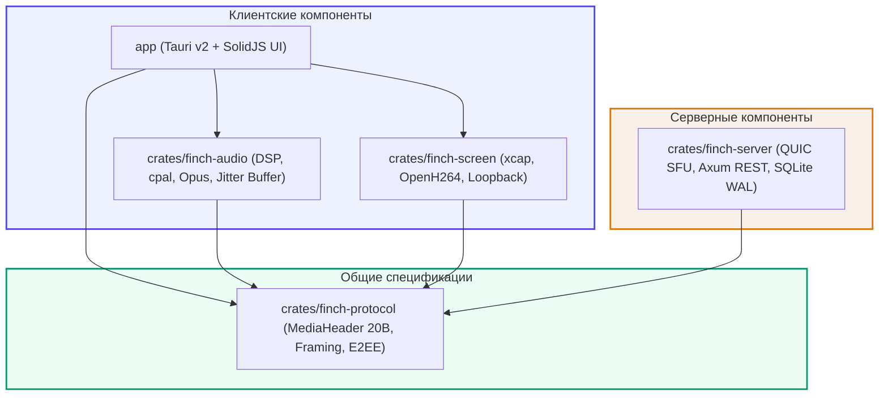

# FinchSpeak

Версия 1.0.0 подготовлена для приёмки на двух ПК. Скачать установщик клиента,
серверный ZIP или portable-пакет: [GitHub Releases](https://github.com/qwers451/FinchSpeak/releases).
Результаты проверок: [RELEASE-VALIDATION](docs/RELEASE-VALIDATION.md).
Проверки владельца: [RELEASE-CHECKLIST](docs/RELEASE-CHECKLIST.md).

<p align="center">
  <strong>Самохостируемый высокопроизводительный голосовой и текстовый мессенджер с демонстрацией экрана на Rust</strong>
</p>

<p align="center">
  
  
  
  
  
  
</p>

---

## 📖 О проекте

**FinchSpeak** — это современная открытая альтернатива коммерческим сервисам голосового и текстового общения (Discord, TeamSpeak), спроектированная с нуля для обеспечения минимальной сетевой задержки, приватности и низкого потребления аппаратных ресурсов.

Ключевой стек технологий:
* **Сервер**: Асинхронное ядро на **Tokio** и **Quinn (QUIC / HTTP/3)** с маршрутизацией медиа-трафика без перекодирования (SFU), REST API на **Axum**, хранилище на **SQLite** в режиме WAL с пулом **SQLx**, аутентификация через **Argon2id** и **JWT**.
* **Десктопный клиент**: Легковесная оболочка **Tauri v2** с реактивным интерфейсом на **SolidJS** и **TypeScript** (сборщик **Vite**).
* **Аудио-подсистема**: Захват звука через **cpal** на нативной частоте ОС, lock-free буферизация на **ringbuf**, полифазный ресемплинг в 48 кГц моно через **rubato**, эхоподавление (AEC3), нейросетевое шумоподавление (**nnnoiseless** RNNoise), локальный VAD и сжатие в **Opus** (20 мс фреймы).
* **Демонстрация экрана**: Захват экрана и окон с помощью **xcap**, сжатие в **H.264** (**OpenH264**), захват системного аудио (**audio_loopback** WASAPI/PipeWire) в Opus stereo 96 кбит/с, передача NAL напрямую в браузерный **WebCodecs API (`VideoDecoder`)** с аппаратной отрисовкой на Canvas.
* **Безопасность**: весь трафик QUIC (голос, экран, чат) шифруется TLS 1.3 между клиентом и вашим сервером; сертификат сервера самоподписанный, клиент проверяет его отпечаток (TOFU, Trust On First Use). Сквозного шифрования (E2EE) нет: сервер, которым вы владеете, технически может видеть медиа-трафик.

---

## 🏛 Архитектура рабочего пространства Cargo

Проект организован как монорепозиторий (Cargo Workspace) со строгим разделением ответственности и архитектурной изоляцией:



### Структура крейтов

| Крейт | Назначение и зависимости |
|---|---|
| [`crates/finch-protocol`](crates/finch-protocol) | **Общий протокол общения**: 20-байтный заголовок `MediaHeader`, типы медиа (`MediaType`), сообщения управляющего потока Stream 0 (`ClientMessage`, `ServerMessage`), кодек фрейминга `LengthPrefixedCodec` и E2EE примитивы (`e2ee_nonce`, `encrypt_media_payload`, `decrypt_media_payload`). Зависит только от `serde`, `rmp-serde`, `bytes`, `chacha20poly1305` и `thiserror`. |
| [`crates/finch-server`](crates/finch-server) | **Серверное ядро и SFU**: Прием QUIC-соединений, веерная рассылка датаграмм по комнатам с принудительной перезаписью `sender_peer_id`, REST API для регистрации, авторизации и загрузки файлов. **Строго изолирован**: зависит только от `finch-protocol` и сетевых библиотек, зависимости от `finch-audio` и `finch-screen` запрещены. |
| [`crates/finch-audio`](crates/finch-audio) | **Аудио-движок**: Двунаправленный звуковой тракт на `cpal`, связь с Tokio через lock-free `ringbuf`, ресемплеры `rubato`, программное и аппаратное эхоподавление (AEC), подавитель шума `nnnoiseless`, кодек `audiopus`, адаптивный Jitter Buffer с монотонным u64 счетчиком и синтезом PLC, микшер с soft-limiting `tanh` и локальным детектором речи. |
| [`crates/finch-screen`](crates/finch-screen) | **Подсистема захвата экрана**: Захват окон и дисплеев через `xcap`, YUV420p конвертер, H.264 энкодер `openh264`, фрагментатор дельта-кадров по 1160 байт, захват системного звука через loopback (WASAPI/PipeWire) с Opus stereo кодированием. |
| [`crates/finch-client-core`](crates/finch-client-core) | **Ядро клиента без UI**: QUIC-сессия (аутентификация, управляющий поток, датаграммы, uni-стримы как события), проверка сертификата TOFU, REST-клиент. Используется приложением и тестовым стендом. |
| [`crates/finch-testbed`](crates/finch-testbed) | **Тестовый стенд** (не публикуется): настоящий сервер в процессе, headless-клиенты, голосовые метрики (задержка, шумоподавление, эхо, VAD), UDP-прокси с потерями и джиттером. |
| [`app`](app) | **Десктопное приложение Tauri v2**: Управление сессиями, соединение с сервером по QUIC, мост бинарного канала `tauri::ipc::Channel` для передачи видеопотока в WebCodecs `VideoDecoder`, реактивный фронтенд на SolidJS. |

---

## ⚡ Ключевые особенности и технические решения

### 1. Сверхкомпактный 20-байтный заголовок MediaHeader
Все медиа-датаграммы (аудио, фрагменты видео, звук экрана) начинаются со строго фиксированного 20-байтного бинарного заголовка:

```text
 0                   1                   2                   3
 0 1 2 3 4 5 6 7 8 9 0 1 2 3 4 5 6 7 8 9 0 1 2 3 4 5 6 7 8 9 0 1
+-+-+-+-+-+-+-+-+-+-+-+-+-+-+-+-+-+-+-+-+-+-+-+-+-+-+-+-+-+-+-+-+
|  Type (1B)    |               Channel ID (4B)                 |
+-+-+-+-+-+-+-+-+-+-+-+-+-+-+-+-+-+-+-+-+-+-+-+-+-+-+-+-+-+-+-+-+
|             Sender Peer ID (4B)               | Sequence (2B) |
+-+-+-+-+-+-+-+-+-+-+-+-+-+-+-+-+-+-+-+-+-+-+-+-+-+-+-+-+-+-+-+-+
|                         Timestamp (4B)                        |
+-+-+-+-+-+-+-+-+-+-+-+-+-+-+-+-+-+-+-+-+-+-+-+-+-+-+-+-+-+-+-+-+
|          Frame ID (2B)        | FragIdx (1B)  | TotFrag (1B)  |
+-+-+-+-+-+-+-+-+-+-+-+-+-+-+-+-+-+-+-+-+-+-+-+-+-+-+-+-+-+-+-+-+
|   Flags (1B)  |
+-+-+-+-+-+-+-+-+
```
* **Короткие session peer ID (`u32`)**: Вместо громоздких 16-байтных UUID используются компактные сессионные ID.
* **Полезна нагрузка датаграммы**: 1160 байт (суммарно 1180 байт с заголовком), что гарантированно укладывается в минимальный IPv6 MTU (1280 байт) без IP-фрагментации.

### 2. SFU без ресурсоёмкого транскодирования с защитой от спуфинга
Сервер `finch-server` работает как легкий SFU (Selective Forwarding Unit):
* Не тратит процессорные мощности на декодирование и повторное сжатие аудио и видео.
* **Обязательная перезапись отправителя**: При веерной рассылке датаграммы сервер перезаписывает байты `5..9` (`sender_peer_id`) гарантированно проверенным ID сессии клиента. Клиенты не могут подделать чужой ID.

### 3. Lock-free аудио-тракт cpal без аллокаций
* Аудио-потоки ввода и вывода `cpal` открываются на нативной частоте и канальности звуковой карты пользователя.
* Передача сэмплов между колбэками звукового потока и воркером Tokio осуществляется через неблокирующие lock-free очереди `ringbuf::HeapRb`. Внутри real-time аудио-колбэков **строго запрещены мьютексы, ожидание блокировок и системные аллокации памяти**.
* Сведение каналов на нативном входе происходит на стеке, после чего звук преобразуется в 48 000 Гц моно через полифазный ресемплер `rubato`.

### 4. Адаптивный Jitter Buffer с защитой от переполнения
* Для восстановления непрерывности потока и синтеза потерянных пакетов (PLC) используется адаптивный буфер дрожания пакетов.
* 16-битный счетчик последовательности `sequence` (`u16`) транслируется в монотонный 64-битный счетчик `u64` через вычисление циклической разности:
  ```rust
  let diff = seq.wrapping_sub(last_seq) as i16;
  ```
  Это гарантирует корректную работу при переполнении `0xFFFF -> 0x0000` без рассинхронизации.

### 5. Локальная индикация активности речи (VAD)
* Активность голоса участников комнаты рассчитывается **локально** в микшере каждого клиента.
* Сервер **не производит** массовую рассылку сообщений `VoiceActivity`, что избавляет сеть и сервер от постоянного шторма мелких управляющих пакетов.

### 6. Демонстрация экрана: WebCodecs + Canvas через бинарный IPC
* Кадры рабочего стола или окна захватываются библиотекой `xcap` и сжимаются в формат H.264 Baseline Profile энкодером `openh264`.
* **Гибридная доставка**:
  - **Ключевые кадры (IDR)**: Передаются через гарантированные однонаправленные стримы QUIC (Uni-Stream).
  - **Дельта-кадры (P-frames)**: Нарезаются на фрагменты по 1160 байт и передаются быстрыми датаграммами. При приеме нового IDR стрима обработка старых дельта-кадров временно блокируется до завершения ключевого кадра.
* **Прямой рендеринг без накладных расходов**: Сжатые NAL-юниты передаются из Rust в интерфейс через высокоскоростной бинарный канал `tauri::ipc::Channel` прямо в браузерный аппаратный декодер **WebCodecs API (`VideoDecoder`)** с выводом на `<canvas>`. В проекте **не используются** локальный HTTP-сервер, генерация fMP4 и программные WASM/JS декодеры.
* **Звук экрана**: Аудио захватывается через петлевой интерфейс (`audio_loopback`) и кодируется в Opus stereo 96 кбит/с (`MediaType::ScreenAudio`).

### 7. Шифрование транспорта и аутентификация TOFU
* Голос, демонстрация экрана и управляющие сообщения идут по QUIC с TLS 1.3 — шифрование между клиентом и сервером.
* Сквозного шифрования (E2EE) клиент не выполняет: FinchSpeak рассчитан на self-hosted сервер, которому доверяют участники. В `finch-protocol` остаются примитивы ChaCha20-Poly1305 (`encrypt_media_payload`, `decrypt_media_payload`) на будущее.
* При первом подключении к серверу клиент валидирует Ed25519 SHA-256 fingerprint сертификата через диалог TOFU (Trust On First Use).

### 8. Надежность и стандарты кода
* Полное отсутствие заглушек `todo!()` и вызовов `unwrap()` / `expect()` в сетевом, серверном и аудио коде.
* Исчерпывающая типизированная обработка ошибок на базе `thiserror` и `Result`.
* 0 предупреждений Clippy (`cargo clippy --workspace --all-targets -- -D warnings`).

---

## 🚀 Быстрый старт

### Системные требования

* **Rust**: актуальный stable (редакция 2024; тот же канал используется в CI).
* **Node.js**: версия `18.x` или новее, менеджер пакетов `npm`.
* **C-компилятор и сборочные инструменты**:
  * **Windows**: Visual Studio C++ Build Tools (MSVC).
  * **Linux**: `build-essential`, `libasound2-dev`, `libpipewire-0.3-dev` (при использовании PipeWire).
* **OpenH264**: Динамическая библиотека `openh264` скачивается автоматически билдером крейта при первой компиляции.

---

### 1. Клонирование репозитория

```bash
git clone https://github.com/qwers451/FinchSpeak.git
cd FinchSpeak
```

---

### 2. Сборка фронтенда

Перед запуском десктопного клиента необходимо собрать фронтенд-приложение на SolidJS:

```bash
cd app/frontend
npm install
npm run build
cd ../..
```

---

### 3. Запуск сервера (`finch-server`)

Сервер читает конфигурационный файл `finch-server.toml` из текущей рабочей директории:

```bash
# Запуск сервера
cargo run -p finch-server
```

По умолчанию сервер открывает:
* **QUIC (UDP)**: `0.0.0.0:4433` (управляющий поток Stream 0 + медиа-датаграммы / Uni-Streams).
* **HTTPS/REST (TCP)**: `0.0.0.0:8443` (регистрация, вход, загрузка файлов). Только TLS — открытого HTTP нет; сертификат тот же, что у QUIC.
* **TLS-сертификат**: самоподписанный, создаётся при первом запуске в `./data/tls` и дальше не меняется. При первом входе клиент показывает его отпечаток SHA-256 — сверьте с отпечатком в логе сервера и подтвердите; после этого пароль отправляется только на сервер с этим сертификатом.
* **Секрет JWT**: если `auth.jwt_secret` не задан, при первом запуске генерируется случайный и хранится в `./data/jwt_secret`.
* **База данных SQLite**: `finchspeak.db` (автоматическое применение миграций при первом запуске).
* **Каталог вложений**: `./data/uploads`.

Пример конфигурации (`finch-server.toml`):
```toml
[server]
host = "0.0.0.0"
quic_port = 4433
http_port = 8443          # HTTPS REST
tls_dir = "./data/tls"    # постоянный сертификат (cert.der, key.der)

[database]
url = "sqlite://finchspeak.db?mode=rwc"

[storage]
upload_dir = "./data/uploads"
max_file_size_mb = 50

[auth]
# jwt_secret не задан: сервер сам создаст случайный в jwt_secret_file.
# Свой секрет можно задать строкой jwt_secret = "..." (длинная случайная строка).
jwt_secret_file = "./data/jwt_secret"
jwt_expiration_hours = 72
```

---

### 4. Запуск десктопного клиента (`finch-app`)

Для запуска клиента в режиме разработки:

```bash
# Через cargo
cargo run -p finch-app
```

Или в режиме горячей перезагрузки UI (Tauri Dev):
```bash
cd app/frontend
npm run dev
# в отдельном окне или через tauri CLI:
# cargo tauri dev
```

---

### 5. Тестирование и линтинг

Прогон всех юнит- и интеграционных тестов рабочего пространства:
```bash
cargo test --workspace
```

Проверка кода строгим линтером с флагом `-D warnings`:
```bash
cargo clippy --workspace --all-targets -- -D warnings
```

Проверка компиляции:
```bash
cargo check --workspace --all-targets
```

Тестовый стенд — настоящий сервер и headless-клиенты: аккаунт, чат, файлы, голосовая сигнализация, экран, E2EE на уровне протокола, устойчивость, качество голоса, плохая сеть:
```bash
cargo test -p finch-testbed
```

Тесты, помеченные `#[ignore = "AUD-NNN"]`, воспроизводят известные проблемы из [отчёта аудита](docs/audit/2026-10-audit-report.md); прогнать их вместе с метриками:
```bash
cargo test -p finch-testbed -- --include-ignored --nocapture
```

Измеренные значения голосовых метрик — в [crates/finch-testbed/BASELINE.md](crates/finch-testbed/BASELINE.md) (строки `BASELINE` в выводе), отладочные WAV последнего прогона — в `target/testbed-out/`. Ручная проверка на реальных устройствах — [docs/audit/manual-voice-checklist.md](docs/audit/manual-voice-checklist.md).

---

## 📂 Дополнительная документация

* **[Генеральный план архитектуры (plan.md)](plan.md)** — Подробное техническое описание всех этапов, форматов кадров, математики джиттер-буфера и спецификаций протокола.
* **[Отчёт аудита (docs/audit/2026-10-audit-report.md)](docs/audit/2026-10-audit-report.md)** — Найденные проблемы, их уровни и план исправлений.
* **[Отслеживание прогресса реализации (PROGRESS.md)](PROGRESS.md)** — Детализированный чек-лист реализованных этапов, статус юнит-тестов и метрики качества кода.

---

## 📄 Лицензия

Проект распространяется под лицензией MIT. Подробности см. в файле [LICENSE](LICENSE).
